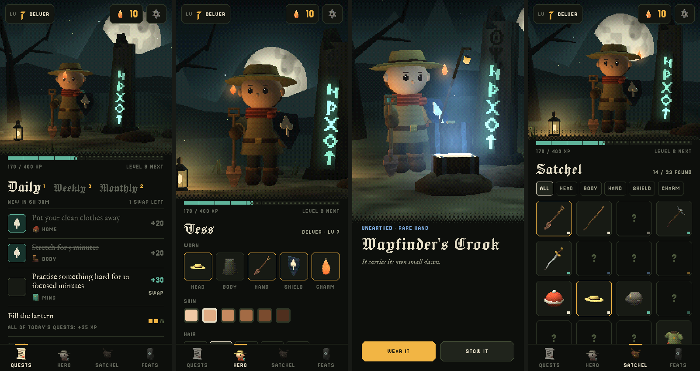

# Spade

Real-life side quests, dealt every day, week and month. Finish them to earn XP, dig up items, collect feats and build up your digger.

Spade is a dark, simple quest app with the feel of a late-90s 3D adventure game: chunky models, fog, a lantern, a big low moon, and dithered pixels.



There are two versions in this repository, and they play by the same rules:

- **The web app** installs on an iPhone from Safari and runs full-screen and offline. It was the prototype.
- **The iPhone app** (`ios/`) is the native version, written in Swift. It adds haptics, daily reminders and the system share sheet, and goes out through TestFlight. See [ios/README.md](ios/README.md).

A save backed up from one loads in the other.

## How it plays

- **Quests.** Three daily, three weekly and two monthly quests are dealt from a built-in deck. Press and hold a quest to seal it.
- **Your own quests.** Write your own and either shuffle them into the deck or pin them so they show every time.
- **XP and levels.** Every quest pays XP. Each level asks for 50 more XP than the last.
- **Dig-ups.** Weekly and monthly quests always unearth an item. Daily quests sometimes do. There are 33 to find.
- **Feats.** 25 achievements, each watching one number such as "best streak".
- **Your digger.** Change skin, hair and scarf, and wear what you find.

It is laid out like a native iPhone app: a floating tab bar, sheets with a grabber that you can drag down to dismiss, grouped settings, touch targets of at least 44 points, and text that follows the phone's text-size setting.

The 3D scene doubles as a progress display:

| In the scene | What it shows |
| --- | --- |
| Lantern flame | Today's dailies. It grows as you finish them, and changes colour on long streaks. |
| Seven runes on the standing stone | The week, Monday at the bottom. A rune lights for each day you finish a daily. |
| Moon phase | The month. A sliver on the 1st, full on the last day. |

## Put the web app on an iPhone

1. Open the app's web address in **Safari**.
2. Tap **Share**, then **Add to Home Screen**.
3. Open Spade from its new icon. It now runs full-screen and works with no signal.

Progress is saved on the device only. Settings has **Back up save**, which opens the share sheet so the save can go to Files or AirDrop, and **Restore from a file** to bring it back.

### Publishing it (one-time setup)

The workflow in `.github/workflows/pages.yml` tests, builds and publishes the app whenever `main` changes.

1. In the repository on GitHub, open **Settings → Pages**.
2. Set **Source** to **GitHub Actions**.

The app then appears at `https://<your-username>.github.io/spade-sidequests/`. Free GitHub Pages needs the repository to be public.

## Run it on a computer

You need [Node.js](https://nodejs.org) 20 or newer.

```bash
npm install
npm run dev       # start the app at http://localhost:5173
npm test          # run the game-rule tests
npm run build     # make the finished app in dist/
npm run preview   # try the finished app, with offline support
npm run icons     # remake every icon size from art/app-icon.png
npm run ios:data  # export models, textures and test examples for the iPhone app
```

While `npm run dev` is running, `http://localhost:5173/dev/stage.html` shows the 3D scene on its own, which is handy when tuning the art. For example: `dev/stage.html?view=hero&gear=hand:barrow_blade,head:straw_hat&month=1`.

## How the code is organised

```
src/
  content/   The game's data as plain JSON: quests, items, feats, colour palettes.
  game/      The rules. Pure TypeScript with no screen code at all.
  three/     The 3D scene: models, lighting, the dither effect, the dig-up.
  ui/        The screens.
  audio/     Sound effects, generated in code.
scripts/     Resizes the app icon, and exports data for the iPhone app.
art/         The app icon's master picture.
dev/         A test page for the 3D scene.
ios/         The native iPhone app (see ios/README.md).
codemagic.yaml   Builds the iPhone app and sends it to TestFlight.
```

A few ideas hold it together:

- **Rules are separate from screens.** Everything in `src/game` is a plain function: it takes the current save and returns a new one, plus a list of what happened. That is why the rules can be tested without a phone (`src/game/game.test.ts`).
- **Models are data.** Nothing is loaded from a 3D model file. Each object is a short list of boxes, cylinders and balls (see `src/three/models`), like a LEGO instruction sheet.
- **Quests are dealt with a seeded shuffle.** The date is part of the seed, so today's quests are the same every time you open the app, and different tomorrow.
- **The look is a recipe.** Light is worked out at the corners of each triangle, textures are tiny and blurry, the scene is drawn small and enlarged with hard pixels, and a dither pattern fakes extra shades (`src/three/RetroMaterial.ts`, `src/three/post.ts`).
- **iPhone conventions, Spade's material.** `src/ui/theme.css` follows iOS layout rules but swaps glass and rounded corners for cut corners and dot patterns. `src/ui/Sheet.tsx` holds the sheet, alert and switch row. `src/ui/platform.ts` talks to the phone: keyboard height, share sheet, haptics, storage.

### Changing things

- **Add or edit quests:** `src/content/quests.json`.
- **Add an item:** describe it in `src/content/items.json`, then give it a model with the same id in `src/three/models/items.ts`. A test checks that every item has a model.
- **Add a feat:** `src/content/achievements.json`.
- **Rebalance XP, levels or loot odds:** `src/game/rewards.ts`.

## The iPhone app

The native app is built from the web app rather than beside it, so the two cannot drift apart:

| Web app | iPhone app |
| --- | --- |
| `src/content/*.json` | Copied unchanged into `ios/Core`. |
| `src/game/*.ts` | Ported function by function to `ios/Core`. Shared worked examples prove both give the same answers. |
| `src/three/models/*.ts` | Exported as shapes to `ios/Spade/Resources/models.json`, which SceneKit builds. |
| Settings → Back up save | The same JSON save loads in both. |

`npm run ios:data` refreshes everything in the right-hand column. Building it, testing it without a Mac, and the full TestFlight setup are in [ios/README.md](ios/README.md).

## Credits

All models, textures, in-app icons and sounds are generated by this project's own code. The app icon is pixel art supplied by the project's owner (`art/app-icon.png`).

Typefaces, under the SIL Open Font License:

- **Jacquard 24** and **Jersey 15** by Sarah Cadigan-Fried
- **IM Fell English** by Igino Marini
