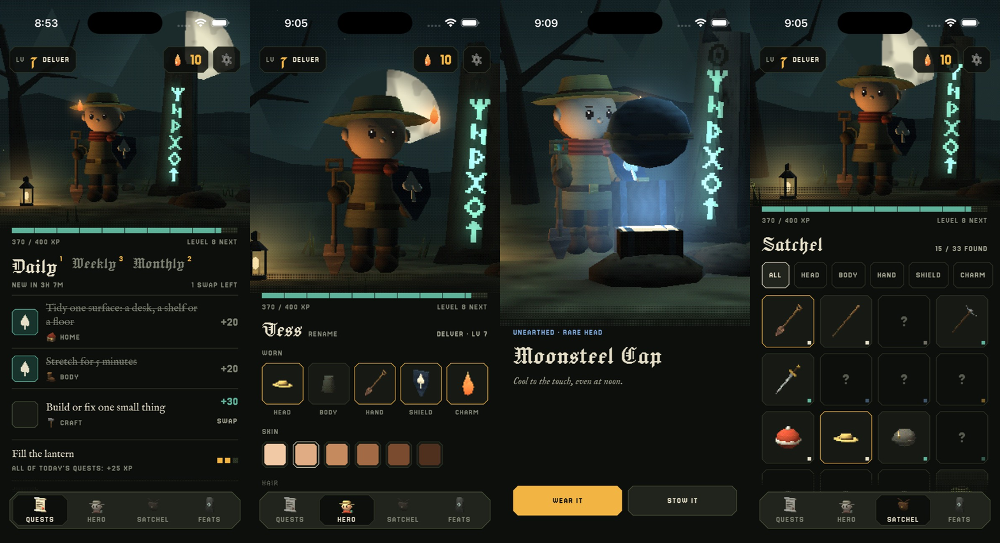

# Spade for iPhone

The native app: Swift, SwiftUI for the screens, SceneKit for the 3D scene.
It needs iOS 17 or newer and runs upright on iPhone.



It plays by exactly the same rules as the web version, and a save backed up from
either one loads in the other.

## What is in here

```
ios/
  Spade.xcodeproj   The Xcode project. One app target, no outside packages.
  Config/           Info.plist: the fonts, and a few settings.
  Core/             The rules of the game. Plain Swift, no screen code, with tests.
  Spade/
    Scene/          The 3D scene: hero, scenery, the dig-up, and the icon camera.
    UI/             The screens.
    Platform/       Sound, haptics and reminders.
    Resources/      Fonts, plus the models and textures exported from the web app.
  ci/               The script that screenshots the app in the iPhone Simulator.
```

Three ideas hold it together:

- **One set of rules.** `Core` is a line-by-line port of `src/game`. The web app
  writes out a few hundred worked examples (`npm run ios:data`), and the Swift
  tests check that they get the same answers: same quests dealt, same loot, same
  levels, same save after a 45-day playthrough.
- **One set of models.** The hero, the items and the scenery are not redrawn for
  iPhone. `npm run ios:data` exports the web app's shapes into
  `Spade/Resources/models.json`, and SceneKit builds them from that.
- **Icons are photographs.** Every icon is a tiny picture of a 3D model, taken by
  a second camera inside the app (`Scene/IconForge.swift`).

After changing quests, items, models or rules in the web app, run `npm run ios:data`
from the repository root and commit what it changes.

## Checking it without a Mac

Every pull request that touches `ios/` runs `.github/workflows/ios.yml`:

- **rules** runs the Swift rule tests on Linux.
- **app** builds the app on a Mac, opens each screen in the iPhone Simulator (a
  current iPhone, then a small one), and saves screenshots. It fails if the 3D
  scene comes out blank on any screen that shows it. Then it makes the same
  release build Codemagic makes, without signing it. The screenshots and build
  logs are under the run's **Artifacts**.

With a Mac: open `ios/Spade.xcodeproj` in Xcode 16 or newer and press Run.
The rule tests run anywhere Swift is installed: `swift test --package-path ios/Core`.

## Getting it onto TestFlight with Codemagic

[Codemagic](https://codemagic.io) builds and signs the app on its Macs, using the
`codemagic.yaml` file at the top of this repository, and uploads it to App Store
Connect. No Mac is needed.

The first build needs some one-time setup. It is mostly making four things and
telling Codemagic about them. Think of it as getting a parcel through customs:
Apple wants to know who is sending it (the **certificate**), what it is (the
**App ID**), a permit that ties those two together (the **provisioning profile**),
and somewhere for it to land (the **app record**).

You need an [Apple Developer Program](https://developer.apple.com/programs/)
membership. Apple only lets adults enrol, so if you are under 18 a parent or
guardian has to own the account and do the Apple steps with you.

### 1. Apple: register the App ID

1. Go to <https://developer.apple.com/account> and open **Certificates, IDs & Profiles**.
2. Open **Identifiers** and press **+**.
3. Choose **App IDs**, then **App**.
4. Description: `Spade`. Bundle ID: **Explicit**, `com.huzkeymil.spade`.
5. Leave every capability unticked. Press **Continue**, then **Register**.

> The bundle ID is the app's permanent name inside Apple's systems. To use a
> different one, change it in three places: `PRODUCT_BUNDLE_IDENTIFIER` (twice) in
> `ios/Spade.xcodeproj/project.pbxproj`, `bundle_identifier` in `codemagic.yaml`,
> and `BUNDLE_ID` in `ios/ci/screenshots.sh`.

### 2. App Store Connect: make an API key

This key is what lets Codemagic talk to Apple for you. Treat it like a password.

1. Go to <https://appstoreconnect.apple.com/access/integrations/api>
   (**Users and Access → Integrations → App Store Connect API**).
2. Press **+**. Name: `Codemagic`. Access: **App Manager**. Press **Generate**.
3. Press **Download API Key**. It can only be downloaded once, so keep the `.p8` file safe.
4. Note the **Issuer ID** (above the table) and the **Key ID** (in the key's row).

### 3. App Store Connect: make the app record

1. Go to <https://appstoreconnect.apple.com/apps> and press **+ → New App**.
2. Platform: **iOS**.
3. Name: this is the App Store name and has to be unique across the whole store.
   Plain "Spade" is probably taken, so use something like `Spade: Side Quests`.
   (The name under the icon on the phone stays "Spade" either way.)
4. Primary language: yours. Bundle ID: pick `com.huzkeymil.spade` from the list.
5. SKU: anything, for example `spade-001`. User Access: **Full Access**. Press **Create**.

### 4. Codemagic: add the repository and the key

1. Sign in at <https://codemagic.io> with GitHub.
2. **Add application**, pick this repository, and choose **iOS App** as the project type.
3. Open **Teams → (your team or Personal Account) → Team integrations → Developer Portal → Connect**.
4. Key name: `spade`. This must match `app_store_connect: spade` in `codemagic.yaml`.
5. Enter the Issuer ID and Key ID from step 2, upload the `.p8` file, and press **Save**.

### 5. Codemagic: make the certificate

1. In the same team settings, open **codemagic.yaml settings → Code signing identities → iOS certificates**.
2. Press **Generate certificate**.
3. Reference name: `spade-distribution`. Type: **Apple Distribution**. Key: `spade`.
4. Press **Create certificate**. Download the file it offers and note the password
   (it is shown only once), then upload that file in the same tab so Codemagic keeps it.

### 6. Apple, then Codemagic: make the provisioning profile

1. Back at <https://developer.apple.com/account>, open **Profiles** and press **+**.
2. Under **Distribution**, choose **App Store Connect**. Continue.
3. App ID: `com.huzkeymil.spade`. Continue.
4. Tick the distribution certificate you just made. Continue.
5. Name: `Spade App Store`. Press **Generate**. (No need to download it.)
6. In Codemagic, open **Code signing identities → iOS provisioning profiles → Fetch profiles**.
7. Tick `Spade App Store`, give it the reference name `spade-app-store`, and press **Download selected**.
   A green tick in the **Certificate** column means it found its matching certificate.

### 7. Build

1. In Codemagic, open the app and press **Start new build**.
2. Branch: `main`. Workflow: **Spade to TestFlight**. Press **Start new build**.

The build takes around ten minutes. When it finishes, Codemagic uploads the app
to App Store Connect.

### 8. Install it from TestFlight

1. In App Store Connect, open the app and go to the **TestFlight** tab.
   The build appears after Apple finishes processing it, usually within half an hour.
2. Under **Internal Testing**, press **+** to make a group, and add yourself.
3. On your iPhone, install the **TestFlight** app, sign in with the same Apple
   account, and install Spade from there.

Internal testers (people on your App Store Connect team) need no review.
To invite people outside the team, fill in **Test Information** in TestFlight,
make an external group, and Apple will review the first build, usually within a day.

### Later builds

Start a new build in Codemagic. Nothing else is needed: each build stamps itself
with the date and time as its build number, so it always counts as newer.
To change the version people see (1.0, 1.1, ...), edit `MARKETING_VERSION` in
`ios/Spade.xcodeproj/project.pbxproj`.

### If a build fails

| The log says | What it means |
| --- | --- |
| `No matching profiles found for bundle identifier` | The profile from step 6 is missing in Codemagic, or its bundle ID differs from `com.huzkeymil.spade`. |
| `App Store Connect API key ... not found` or `integration` errors | The key name in step 4 is not `spade`. Rename it, or change `codemagic.yaml` to match. |
| `No suitable application records were found` | The app record from step 3 does not exist yet, or uses a different bundle ID. |
| `You already have a current Distribution certificate` | Apple allows three distribution certificates. Remove an old one at developer.apple.com, or fetch the existing one into Codemagic. |
| `The bundle version must be higher than the previously uploaded version` | A build with a later date was already uploaded. Start the build again. |

## Sending it to the App Store

TestFlight builds and App Store builds are the same file. When the app is ready:
in App Store Connect, open the **Distribution** tab, fill in the listing
(screenshots, description, age rating, privacy answers), choose a build, and
press **Add for Review**. Spade collects no data and has no accounts, so the
privacy answer is "Data Not Collected".
